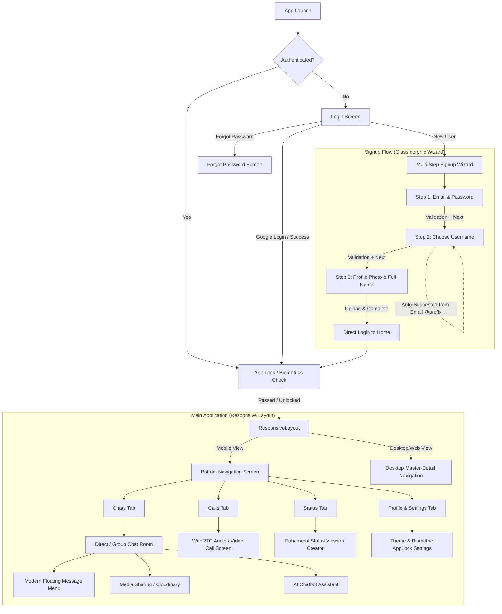

# Cuqter

<div align="center">
  
</div>

Cuqter is a feature-rich, cross-platform messaging and social networking application built with Flutter. It seamlessly operates across Mobile, Web, and Desktop environments, providing a smooth and responsive experience. Cuqter utilizes Firebase as its robust backend infrastructure and incorporates cutting-edge technologies like WebRTC for real-time communication, Google Generative AI for advanced conversational features, and a modern glassmorphic UI.

## 🌟 Key Features

### 💬 Messaging & Social
- **Real-Time Chat**: Powered by Firebase Firestore and Realtime Database for instantaneous message delivery.
- **Modern Message Menu**: Intuitive, segmented floating context menu for reacting, replying, copying, and deleting messages.
- **Media & File Sharing**: Effortlessly share images, videos, audio recordings, documents, and locations.
- **Status Updates**: Share and view ephemeral photo/video statuses with your contacts.
- **AI Chatbot Integration**: Integrated with Google Generative AI for intelligent in-app assistance.

### 🎨 UI & UX Experience
- **Glassmorphic Design**: Beautiful frosted glass effects, subtle gradients, and modern floating UI elements.
- **Multi-Step Onboarding**: A seamless, paginated signup flow complete with profile picture upload.
- **Responsive Layout**: Custom adaptive UI that scales perfectly between mobile (bottom navigation) and desktop/web (centered layouts with constrained widths).
- **Dynamic Theming**: Comprehensive Dark and Light modes using Provider-based state management that adapts safely to contrast constraints.

### 📞 Audio & Video Calls
- **WebRTC Integration**: High-quality peer-to-peer audio and video communication using WebRTC.
- **CallKit Integration**: Native incoming call screens using CallKit for a seamless OS-level experience.

### 🔒 Security & Privacy
- **App Lock**: Built-in security leveraging device biometric authentication (Fingerprint/FaceID).
- **Session Management**: Monitor and manage active sessions securely across multiple devices.
- **Block & Report**: Built-in tools for user safety and privacy management.

### 🔔 Notifications
- **Push Notifications**: Stay connected with Firebase Cloud Messaging (FCM) for background and foreground notifications.

## 📱 Application UI & Navigation Flow

Cuqter provides a streamlined, user-friendly flow designed to minimize friction while maintaining high visual polish.



### 1. 🔐 Authentication & Onboarding
* **Login Screen**: Glassmorphic frosted glass card supporting username or email login, biometric session restore, and single-click Google Sign-In.
* **3-Step Signup Wizard**:
  * **Step 1: Account Credentials** — Enter email and secure password; also features alternative Google Sign-In.
  * **Step 2: Choose Username** — Automatically parses the email prefix (characters before `@`) and provides clickable smart suggestion chips (e.g. `@johndoe`, `@john_doe`) with live character validation.
  * **Step 3: Profile Setup** — Instant avatar picker with camera, native gallery, or internal asset manager integration backed by Cloudinary; full name entry.
  * **Seamless Landing** — Directly launches into the main authenticated layout without dropping users back onto the login screen.

### 2. 📱 Responsive Main Layout
* **Mobile Experience**: Ergonomic bottom navigation bar with fluid icon transitions across **Chats**, **Calls**, **Status**, and **Profile**.
* **Desktop & Web Experience**: Adaptive two-column master-detail view with persistent side navigation bar, maximized viewing area, and centered constraint limits.

### 3. 💬 Chat & Interaction Experience
* **Floating Reaction & Action Pill**: Long-pressing a message reveals modern emoji reactions (`❤️`, `👍`, `🔥`, `😂`, `😮`, `😢`) along with reply, copy, pin, forward, and delete actions.
* **Media & Cloudinary Pipeline**: Secure, non-blocking media upload directly to Cloudinary with real-time delivery over Firebase Firestore.
* **Dynamic Theming**: Seamless real-time switching between curated dark mode (slate accents) and light mode with high-contrast accessibility.

## 🏗️ Tech Stack & Architecture

Cuqter follows a modern mobile development architecture pattern, separating UI, state management, and core services.

### Core Technologies
- **Frontend Framework**: [Flutter](https://flutter.dev/) (Dart) 
- **Backend Infrastructure**: [Firebase](https://firebase.google.com/) (Authentication, Firestore, Storage, Realtime Database, Cloud Messaging, Remote Config)
- **Real-time Communcation**: [WebRTC](https://webrtc.org/)
- **State Management**: [Provider](https://pub.dev/packages/provider)
- **Routing**: [GoRouter](https://pub.dev/packages/go_router)
- **AI Engine**: Google Generative AI (`google_generative_ai`)
- **Location Services**: Geolocator

### Architectural Flow
1. **Presentation Layer (`lib/Screen/`)**: Contains the UI elements. Widgets react to state changes provided by the State Layer.
2. **State Layer (`lib/providers/`)**: Houses `ChangeNotifier` classes that hold app state globally (e.g., `ChatProvider`, `ThemeProvider`).
3. **Service Layer (`lib/services/`)**: Interfaces with external APIs, Firebase, WebRTC Signaling, Biometrics, and Deep linking. Abstracts the complex backend logic from the UI.

## 📂 Full Project Structure

```text
lib/
├── Account/                # Authentication screens (Login, Signup, Forgot Password)
├── Screen/                 # Core application UI modules
│   ├── calls/              # Audio & Video call interfaces (WebRTC logic integration)
│   ├── chat/               # Messaging views, Chat AI, modern action menus
│   ├── home/               # Main navigation (Bottom nav, Sidebar for Desktop)
│   ├── media/              # Media viewing, camera, picking, and cropping interfaces
│   ├── profile/            # Responsive user profile management, QR scanner, contacts
│   ├── settings/           # App configuration, security, privacy, AppLock, sessions
│   └── status/             # Ephemeral status update viewing and creation
├── modules/                # Core data models and entities (User, Message, Status)
├── providers/              # State management controllers (ThemeProvider, ChatProvider)
├── resources/              # Authentication and Storage methods
├── responsive/             # Responsive layout builders (Mobile/Desktop/Web logic)
├── services/               # Core business logic and external integrations
│   ├── biometric_service.dart     # Device authentication (App Lock)
│   ├── signaling_service.dart     # WebRTC signaling logic for calls
│   ├── deep_link_service.dart     # URL navigation within the app
│   ├── session_service.dart       # User session tracking
│   └── notification_service.dart  # FCM push notification handling
├── utils/                  # Shared utilities, global variables, custom UI helpers
├── widgets/                # Reusable, shared UI components across the app
└── main.dart               # App entry point, Firebase init, MultiProvider setup
```

## 🚀 Getting Started

### Prerequisites
1. Ensure you have the [Flutter SDK](https://flutter.dev/docs/get-started/install) installed (version `^3.11.1` recommended).
2. Install a compatible IDE (VS Code, Android Studio) with Flutter and Dart extensions.

### Installation & Setup

1. **Clone this repository:**
   ```bash
   git clone https://github.com/your-username/cuqter.git
   cd cuqter
   ```

2. **Install dependencies:**
   ```bash
   flutter pub get
   ```

3. **Firebase Configuration:**
   - Create a project on the [Firebase Console](https://console.firebase.google.com/).
   - Enable Authentication (Email/Password, Google Sign-In), Firestore, Storage, Realtime Database, and Cloud Messaging.
   - Run the FlutterFire CLI to configure your project:
     ```bash
     flutterfire configure
     ```
   - This will generate the required `firebase_options.dart` file in your `lib/` directory.

4. **Run the application:**
   ```bash
   flutter run
   ```

## ⚙️ Background Operations & Security
- **App Lock**: Managed by the `AppLockWrapper` in `main.dart`, which monitors `AppLifecycleState` and triggers the `AppLockScreen` upon resuming from the background, leveraging `BiometricService`.
- **Background Messaging**: Cuqter handles Firebase messages in the background using an isolated `@pragma('vm:entry-point')` handler located in `main.dart`.
- **Active Sessions**: Users can view and manage their active sessions from the settings page, ensuring unauthorized access is mitigated.
- **Deep Linking**: Seamlessly handles incoming URLs even when the app is in the background or terminated using `app_links` and `go_router`.

---
*Built with ❤️ using Flutter.*
